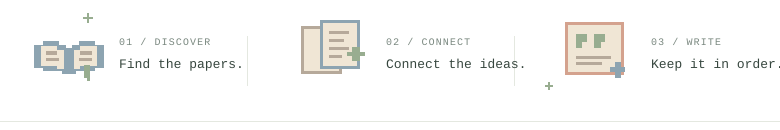

<h1 align="center">
  PaperCash
  
</h1>

<p align="center">
  <picture>
    <source media="(prefers-color-scheme: dark)" srcset="docs/assets/typing-dark.svg" />
    
  </picture>
</p>

<p align="center">
  <strong>找论文，理思路，让写作慢慢清晰。</strong><br />
  一个陪你整理文献、引用与写作思路的好帮手。
</p>

<p align="center">
  <a href="https://jesseovo.github.io/PaperCash/">论文发现页 ↗</a> &nbsp;·&nbsp;
  <a href="#quick-start">一句话开始</a> &nbsp;·&nbsp;
  <a href="#on-the-desk">能帮你做什么</a> &nbsp;·&nbsp;
  <a href="#sources">数据源</a> &nbsp;·&nbsp;
  <a href="SKILL.md">Agent 指南</a><br />
  <sub>Python 3.10+ &nbsp; / &nbsp; v2.0.0 &nbsp; / &nbsp; <a href="LICENSE">MIT License</a></sub>
</p>

<p align="center">
  <a href="https://jesseovo.github.io/PaperCash/">
    <picture>
      <source media="(prefers-color-scheme: dark)" srcset="docs/assets/reading-desk-entry-dark.svg" />
      
    </picture>
  </a>
</p>

在[论文发现页](https://jesseovo.github.io/PaperCash/)随手翻一篇，把感兴趣的研究放进书签，带走一份引用。想再读深一点，就把论文和来源一起交给 Agent。

<a id="quick-start"></a>

## 一句话，交给你的 Agent

复制下面这句话，发给能执行本地命令的 Agent：

```text
帮我安装 https://github.com/Jesseovo/PaperCash ，
按 SKILL.md 配置独立环境并验证可用，然后问我想研究什么。
```

环境准备好后，直接告诉它你的主题。PaperCash 的调用方式与使用边界都写在 [SKILL.md](SKILL.md) 中，Agent 可以据此选择工具。

<p align="center">
  <picture>
    <source media="(prefers-color-scheme: dark)" srcset="docs/assets/research-desk-dark.svg" />
    
  </picture>
</p>

<a id="on-the-desk"></a>

## 你的研究，它来搭把手

###  &nbsp; 找到下一篇值得读的论文

从研究主题开始，检索标题、作者、年份、DOI、链接及可用摘要。

```text
帮我检索 10 篇医学影像分割相关论文，整理可用摘要，并保留 DOI 和来源链接。
```

###  &nbsp; 把散落的文献整理成阅读起点

基于检索到的**元数据与摘要**生成文献整理初稿，并可导出 Word。适合先建立阅读线索；方法、结论与研究空白仍需回到全文核实。

```text
围绕医学影像分割整理一份摘要级文献初稿，用 GB/T 7714 格式列出引用，导出 Word。
```

###  &nbsp; 给引用和格式留一个整齐的位置

通过 DOI 生成引用初稿，支持 **GB/T 7714、APA、MLA、Chicago 和 BibTeX**；也能按内置常见格式样例检查 Word 文档。

```text
把 DOI 10.1038/s41586-021-03819-2 整理成 APA 引用，再帮我检查这份 Word 的格式。
```

<details>
<summary><strong>还有一些写作小帮手</strong> · 大纲、扩写思路、表达修改与相似内容预检</summary>

| 需要做的事 | 可以这样说 |
| --- | --- |
| 起草论文大纲 | 帮我给“医学影像分割方法研究”起草一份大纲。 |
| 获取扩写思路 | 这段话还能从哪些角度展开？先给我思路和模板。 |
| 修改学术表达 | 帮我润色这段话，保留原意。 |
| 相似内容预检 | 用 PaperCash 对这段话做一次相似内容预检，并保留候选来源。 |
| 表达修改建议 | 检查这段话的表达，保留数据和引用，修改前先让我确认。 |

`check` 将句子与候选文献的标题、摘要比较；没有候选时返回“无法判断”。相似度不是正式查重率，也不能证明抄袭或原创。

`humanize` 只提供有限的表达修改建议，不能预测或保证 AI 检测结果。运行时需要交互确认，默认保留识别到的数据、公式、法条和引用所在句。

`expand` 提供思路和模板，不补造研究事实。`check` 与 `humanize` 会在本机 `~/.papercash/audit/` 记录时间、命令、输入摘要及长度，不保存原文。

</details>

<a id="sources"></a>

## 从哪里找到文献

**网页书单**收录 arXiv 近期预印本，以及 Crossref 近一年按主题检索的期刊论文，每天北京时间 08:20 左右更新。支持关键词与主题筛选、当前浏览器收藏、GB/T 7714 / APA / BibTeX 引用复制，以及收藏书单的 BibTeX 导出；来源与更新状态可以在网页底部查看。

**交给 Agent 使用时**，PaperCash 可以按你的研究主题继续检索更多来源：

默认尝试 **Semantic Scholar · arXiv · Crossref · 百度学术**。配置相应代理或 Cookie 后，Google Scholar、知网和万方也会参与默认检索；PubMed 可通过 `--sources pubmed` 指定。

数据源的可用性取决于网络、接口限制和访问配置。遇到问题时，可以直接让 Agent 检查 PaperCash 的数据源连通性。

<details>
<summary><strong>可选配置</strong> · API Key、代理与 Cookie</summary>

配置可写入 `~/.config/papercash/.env`、当前目录的 `.papercash.env`，或环境变量。

| 变量 | 用途 |
| --- | --- |
| `SEMANTIC_SCHOLAR_API_KEY` | Semantic Scholar API Key |
| `GOOGLE_SCHOLAR_PROXY` | Google Scholar 代理配置 |
| `CNKI_COOKIE` | 知网访问 Cookie |
| `WANFANG_COOKIE` | 万方访问 Cookie |

请使用自己有权访问的数据源凭据。配置完成或诊断可访问，并不保证每次检索都有结果；数据源失败与零结果应分别判断。

</details>

## 带回写作之前

每一条论文和引用都应该能回到来源。提交前，核对标题、作者、年份、DOI 与出版信息；引用规范和 Word 排版要求以学校或期刊模板为准。完整功能与使用边界见 [SKILL.md](SKILL.md)。

<details>
<summary><strong>给开发者</strong> · 命令入口、反馈与验证</summary>

运行环境为 Python 3.10+，依赖见 `requirements.txt`。如需直接使用 CLI：

```bash
python scripts/papercash.py --help
python scripts/papercash.py --diagnose
```

如果你遇到问题，欢迎提交 [Issue](https://github.com/Jesseovo/PaperCash/issues)，附上使用的命令、Python 版本和去除个人信息后的报错。

本地开发验证：

```bash
python -m pip install pytest
python -m pytest -q
```

测试不依赖线上数据源。修改数据源相关行为后，可另做少量实时检索验证。

</details>

<p align="center">
  <picture>
    <source media="(prefers-color-scheme: dark)" srcset="docs/assets/little-desk-dark.svg" />
    
  </picture>
  <br />
  <sub>Made with curiosity by <a href="https://github.com/Jesseovo">Jesse</a> &nbsp;·&nbsp; <a href="https://jesseovo.qzz.io/">Little corner on the web</a> &nbsp;·&nbsp; <a href="LICENSE">MIT</a></sub>
</p>
